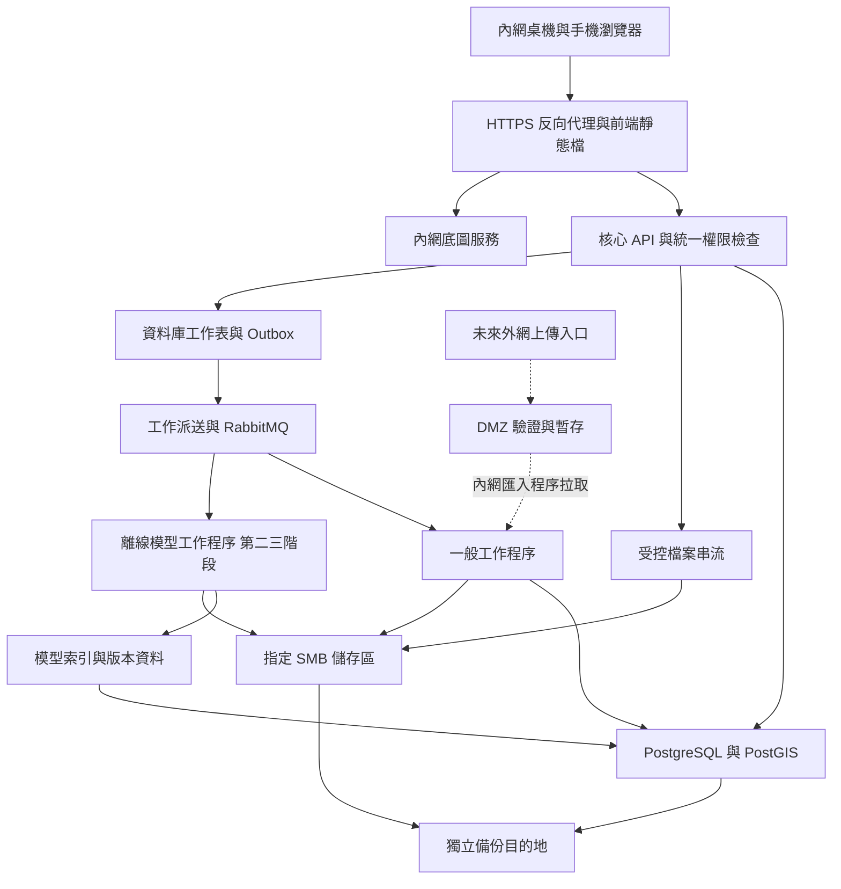
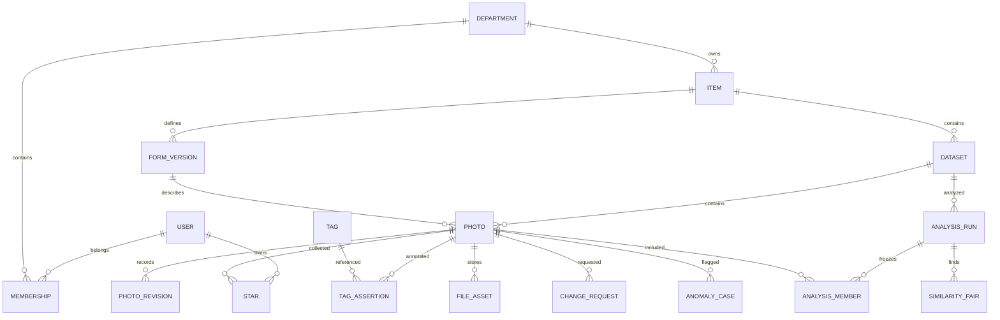

# 機關內部照片管理系統技術方案

日期：2026-11-23。業務基準：已確認訪談 Q1–Q80。用途：作為設計審閱、實作拆分與驗收依據。

後續修訂：使用者已將項目與資料集合一，操作層級改為「科室 → 資料集 → 照片」；表單範本為引用資料，不再是額外分類層。比對距離可於當次操作調整 100–1000 公尺，時間採單軌雙把手，疊合可直接拖曳。以下原四層模型與管理者固定半徑描述，以 [ADR 0014](adr/0014-dataset-tree-and-comparison-controls.md) 為準；本機先保留原儲存關聯，正式 schema 依此修訂。

採用「三個操作入口、單一核心後端、獨立背景處理」：照片原檔放指定網路芳鄰，權限、表單及檢索資料放資料庫；所有正式服務與底圖在內網運作。第一階段完成照片管理，第二階段接入離線語意搜尋與手動近似分析，第三階段建置人員名冊及人臉搜尋，外網上傳另行部署。

業務規則已確認；以下程式框架、主機配置、索引及 API 為建議實作方案，不代表已部署或已通過效能測試。具體套件修補版本於實作時鎖定並記錄相容性。本文件是整合規格；決策理由保留於 [ADR 目錄](adr/)，術語依 [名詞表](../GLOSSARY.md)。[驗收清單](ACCEPTANCE-CHECKLIST.md) 可直接用於測試追蹤。

## 1 系統範圍與不變條件

| 項目 | 已確認規則 |
|---|---|
| 業務層級 | 科室 → 項目 → 資料集 → 照片；每張照片只有一個歸屬 |
| 表單 | 項目定義表單，照片綁定發布版本；歷史照片不自動遷移 |
| 圖台 | 左側科室、項目、標籤多選；地圖群聚與照片清單連動 |
| 篩選 | 同類條件 OR、不同類 AND；自訂欄位僅在單項目下篩選 |
| 附近比對 | 基準座標半徑預設 100 公尺，管理者調整且不得小於 100；包含邊界，可跨授權資料集 |
| 近似分析 | 使用者啟動、單資料集、全選或部分選取、固定當次名單；不在上傳後自動掃描 |
| 時間異常 | 拍攝時間差嚴格超過預設 24 小時，門檻由管理者設定；時間不確定不直接判定 |
| 人工整理 | 個人星號；共享標籤與人工異常獨立於模型結果 |
| 刪除 | 正式照片申請核准後進回收區；第一版不永久清除 |
| 機關內網 | 原圖、資料庫、底圖、模型、字型及程式依賴不依賴外網運行 |
| 設計規模 | 100 萬張、單資料集 1 萬張驗收、100 人同時使用含 10 人上傳；每批 500 張、每張 50 MB |

第一版不含 RAW、影片、Live Photo 動態部分、自動影像對齊、手機離線同步、匿名投稿、跨項目或跨科室搬移。語意搜圖不自動改分類；人臉候選不自動變成正式人物關聯；近似命中不直接認定造假。

## 2 部署架構

### 2.1 技術組合

| 層次 | 建議方案 | 理由與限制 |
|---|---|---|
| 前端 | Vue 3、TypeScript、Vite | 三入口共用表單、照片檢視器、權限提示及查詢狀態；以瀏覽器應用部署 |
| 地圖 | Leaflet 穩定版、伺服器群聚查詢 | 輕量地圖；不把百萬個點傳到瀏覽器，不依賴前端插件承擔全部群聚 |
| 後端 | Python、Django 5.2 LTS、REST API | 模組化單體，集中處理帳號、交易與工作流；使用正式修補版本，不固定最初的 5.2.0 |
| 資料庫 | PostgreSQL、PostGIS；第二階段加入 pgvector | 關聯資料、地理距離與向量索引共用備份及維運；選擇擴充套件共同支援的穩定版本 |
| 背景工作 | Celery、RabbitMQ；工作狀態以 PostgreSQL 為準 | 長工作與互動請求分離，佇列只傳工作 ID，不傳原圖或大量個資 |
| 圖片處理 | ExifTool、libvips 與所需 HEIC 解碼器 | 原始資訊讀取、方向處理、縮圖及預覽；所有解碼在受限工作程序進行 |
| 入口 | Nginx、機關憑證、同網域 HTTPS | 不公開 SMB 路徑；靜態前端與 API 同源，簡化登入與 CSRF 管理 |
| 模型 | Python 模型介面，按模型使用 PyTorch 或 ONNX Runtime | 不同模型可替換；與核心 API 分開配置 CPU、記憶體及 GPU |
| 部署 | Linux VM／容器，私有套件與映像倉庫 | 開發可在 Windows，正式環境不以個人工作站或 Docker Desktop 作服務主機；若機關限制 Linux，部署前調整方案 |

Vue 提供 TypeScript 整合，Django 5.2 為 LTS，Leaflet 支援底圖圖層；Celery 官方列 RabbitMQ 為穩定 broker 並要求可重試工作考慮冪等性。這些能力支持上述選擇，並不保證本系統已達容量目標。[Vue](https://vuejs.org/guide/typescript/overview.html)、[Django](https://docs.djangoproject.com/en/5.2/releases/5.2/)、[Leaflet](https://leafletjs.com/)、[Celery broker](https://docs.celeryq.dev/en/stable/getting-started/backends-and-brokers/index.html)、[Celery tasks](https://docs.celeryq.dev/en/stable/userguide/tasks.html)

### 2.2 網路與主機邊界

瀏覽器只能連 HTTPS 入口；資料庫、broker、模型埠、SMB 不對使用者網段或外網公開。API 與工作程序使用不同服務帳號；匯入來源只讀，系統儲存區按用途給讀寫權限。密碼、SMB 憑證及簽章金鑰放部署秘密設定，不寫入程式庫、工作參數或稽核內容。

第一版採可備份還原的單套服務，不承諾無中斷高可用；主機故障依復原目標處理。建議應用與一般工作、資料庫分 VM，避免縮圖壓滿資料庫資源；模型可後續加獨立 GPU 主機。初期可共用實體虛擬化平台，但仍有平台單點風險。

底圖先接機關既有內網圖資；若無，另部署具合法離線使用權的圖磚。圖資範圍、縮放層級、更新周期與容量列為部署依賴，不假設可批次下載公開圖磚。地址查詢、字型、地圖標示及 JS/CSS 也不得偷偷呼叫外部服務。

### 2.3 硬體與容量估算

下表為負載測試起點，非採購定案或效能保證。先檢查機關既有虛擬化平台、SMB 吞吐與備份設備，再決定實際配置。

| 資源 | 起始估算 |
|---|---|
| 應用與一般 worker | 8 vCPU、16–32 GB RAM；接收暫存可用 SSD 500 GB 起並設配額 |
| 資料庫 | 8–16 vCPU、32–64 GB RAM、獨立 SSD 500 GB 起；向量與索引另測量 |
| 模型主機 | 第二階段另評估；CPU 可作原型，GPU 型號及 VRAM 依實際選定模型和併發決定 |
| 原圖與衍生圖 | 依實際平均大小與年增量計算；不能把每張上限當平均值 |
| 備份 | 獨立於原圖儲存的故障域；容量含資料變動量及 30 天保留 |

示例：100 萬張 × 平均原圖 8 MB 約 8 TB；平均縮圖與預覽合計 0.8 MB 再約 0.8 TB，預留 30% 約 11.44 TB，尚未含草稿、回收區、匯出包、底圖及備份。若全部接近 50 MB，原圖即可達約 50 TB。這些為十進位估算，須用樣本量測修正。

10 人各上傳一批 500 張、每張 50 MB，可產生 250 GB 接收量；須流式接收、限制併發及預留磁碟，不能把整批留記憶體。容量不足時拒絕新接收並回報逐檔結果，不丟棄已驗證完成檔案。

## 3 模組與資料模型

核心模組分為 identity、catalog、forms、photos、search、annotations、workflow、jobs、exports、audit。第二三階段加入 model_registry、similarity、people。各模組可在同一後端專案，以服務函式劃分責任；不直接讓前端修改資料表或以資料庫管理介面代替業務後台。

### 3.1 核心關聯

圖示只畫主關係；以下表格為實作實體清單。識別使用 UUID，時間與使用者來源明確記錄，歷史不可因帳號停用而失去關聯。

| 實體 | 主要資料與約束 |
|---|---|
| User、AuthIdentity、Session | 帳號啟用狀態、登入來源、外部 subject、權限版本；可一人多登入身分但不以姓名合併 |
| Department、Membership | 科室狀態；使用者與科室多對多、有效期間及主管角色 |
| PermissionGrant | capability、department/item scope、授權者與時間；跨科室閱覽不隱含操作權 |
| Item | 所屬科室、名稱、啟停狀態、目前表單版本；有歷史不能刪除 |
| Dataset | item_id、名稱及正規化名稱、建立者、封存狀態、可設配額、row_version；同項目名稱唯一含封存 |
| FormVersion、FieldDefinition、FieldOption | 不可變發布版本、穩定欄位及選項 ID、型別、排序、必填、篩選設定；改型別建立新識別 |
| Photo | dataset_id、form_version_id、原上傳者、目前草稿承辦者、生命週期、storage_state、metadata_flags、row_version |
| PhotoRevision | 每次正式資料更正的表單 JSONB、有效時間位置、來源、理由、申請關聯；修改不覆寫原 EXIF |
| PhotoFieldValue | 可重建的已指定篩選欄位索引，按型別分欄；與表單版本及 revision 關聯，不是另一份人工真相 |
| FileAsset | photo_id、角色 original/preview/thumb、storage_key、SHA-256、大小、MIME、解碼與驗證狀態；原檔不可覆寫 |
| UploadBatch、UploadFile、ImportJob | 操作者、目的地、續傳識別、逐檔狀態、來源資訊、重複檔理由、失敗原因與冪等鍵 |
| Tag、TagAlias、TagAssertion | 科室標籤、合併指向、操作來源、assertion_id、撤回時間；同照片可有多個支持同標籤的來源 |
| Star | user_id + photo_id 唯一；不共享、不評分 |
| ChangeRequest、RequestEvent | 更正/刪除/搬移/權限異動、申請者、基準版本、提案內容、狀態、審核者及事件；重送連結前案 |
| AnomalyCase、AnomalyEvent | 照片、類型、說明、狀態、提出與結案者、結案理由、重開事件、可選分析配對來源 |
| Notification | 收件者、事件 ID、已讀時間、受控目標引用；已讀不影響案件狀態 |
| Job、JobItem、Outbox | 任務狀態、取消旗標、心跳、重試次數、成員與設定摘要；交易內寫 Outbox，提交後派送 |
| AnalysisRun、AnalysisMember | dataset_id、發起者、名單摘要、模型及門檻版本；每成員保存 photo/revision/hash/time snapshot |
| SimilarityPair、PairReview | 正規化左右照片 ID、各種分數、時間差及品質、檢閱狀態、檢閱者；同 run 同 pair 唯一 |
| ModelVersion、PhotoEmbedding | 檔案雜湊、授權來源、前處理版本、維度、距離方式、啟用狀態；向量按模型分開 |
| Person、PersonReference、FaceObservation、PersonPhotoLink | 第三階段：科室人物 UUID、姓名、參考照片、多臉觀測與向量、人工確認關聯及事件 |
| ExportJob、ExportMember | 固定名單與欄位、授權版本、產物、到期時間、下載紀錄；不提供永久直接網址 |
| AuditEvent、SystemSettingVersion | 操作與設定歷史、必要前後差異、request_id；應用服務僅追加稽核 |
| BackupManifest | 一致性時間點、原檔清單及雜湊、資料庫備份與 WAL 範圍、驗證狀態 |

### 3.2 時間與座標

保留 EXIF 原始字串、原時區偏移、解析結果、effective_capture_at、timezone_status、confirmed_by/time。已確定時間以 timestamptz 儲存；無時區先以 Asia/Taipei 推定並標記，允許瀏覽與人工確認，不能把推定包裝成已知。上傳時間是另一欄，永不替代拍攝時間。可疑時間或位置確認理由獨立保存。

位置以 WGS84 geography(Point,4326) 儲存有效座標，另存原始 GPS 與修正來源。地圖顯示投影與儲存座標分離，輸入與 API 明確定義經度在前或具名 lat/lon，避免顛倒；非法值列待補，合法零度或區外值警示不直接判錯。

日期查詢實作成起日 00:00 含、迄日次日 00:00 不含的半開區間，再換算 UTC，確保包含完整迄日及小數秒。未知時間以 NULL 配合品質旗標，不填入 1970 年或上傳時間。

### 3.3 狀態分離

照片生命週期 draft → submitted → recycled；復原回到回收前的 draft 或 submitted，不自動重送失效案件。草稿承辦人可更換，原上傳者保持不變。

檔案狀態 receiving/verifying/ready/unavailable/corrupt 與照片生命週期分離；資料品質 missing_time/missing_location/inferred_timezone/suspicious 可同時存在。「待補」不是另一種刪除狀態。網路暫時中斷先標示 unavailable，不立即認定永久遺失。

申請為 pending → approved/rejected/withdrawn/invalidated；審核交易同時更新照片與事件。異常為 pending → confirmed/dismissed，可附理由重開。工作為 queued/running/succeeded/failed/cancelled，部分輸出帶 incomplete 標記，不顯示完整成功。

### 3.4 交易、索引與歷史

dataset 與 item 的歸屬透過外鍵與服務驗證保持一致；資料庫唯一約束防止資料集重名、重複星號及重複配對。審核以 row_version 和行鎖確保只結案一次，衝突回 409 與可閱覽的最新資料，不用最後寫入者覆蓋。

索引包括 geography GiST、dataset/status/capture_at/id 複合索引、科室有效授權、標籤反向索引、pending 申請與工作部分索引。可篩選表單欄位使用 typed index projection；文字依實際查詢測試 trigram，不為每個任意 JSON 路徑建立索引。列表使用穩定時間及 ID 游標分頁。

照片原檔不做跨資料集實體去重，避免刪除參照與跨科室資訊側漏複雜化；相同檔案仍可有獨立業務紀錄。查重只在有權操作的目前資料集提示。索引與派送狀態可重建，正式照片、人工註記及稽核不得視為可隨意重建的暫存。

## 4 權限矩陣

權限判斷為「帳號有效 AND 當前科室／項目範圍 AND capability AND 資料狀態 AND 個人限制」。角色只是一組預設授權；可兼任多科室，調職不自動帶走舊權限。所有 API、圖片、群聚數字、通知目標、索引結果及下載都用相同 PolicyService。

下表為預設；「所管」限主管管轄科室，「另授」不因角色自動取得。系統管理者全域閱覽與核心管理不等於自動開啟所有人物及稽核專用功能。

| 操作 | 一般科室同仁 | 跨科室僅閱覽者 | 科室主管 | 系統管理者 |
|---|---|---|---|---|
| 查詢、預覽正式照片 | 本科 | 授權範圍 | 所管 | 全部 |
| 個人打星 | 可閱覽照片 | 可閱覽照片 | 可閱覽照片 | 可閱覽照片 |
| 原圖下載 | 本科預設 | 另授 | 所管 | 全域核心權限 |
| 上傳、建立資料集 | 授權項目 | 另授 | 所管授權項目 | 全域 |
| 草稿編輯、放棄 | 自己／指派 | 無 | 所管可接管 | 全域可接管 |
| 資料集改名與說明 | 建立者且仍有範圍權 | 無 | 管理所管 | 全域 |
| 封存、重新開放 | 無 | 無 | 所管 | 全域 |
| 共享標籤、提出異常 | 本科整理權預設 | 另授 | 所管 | 全域核心權限 |
| 更正／刪除／搬移申請 | 本科整理權 | 另授整理權 | 所管 | 可直接處理並填理由 |
| 核准、駁回申請 | 無 | 無 | 所管；本人申請交他人 | 全域並留理由 |
| 確認／排除／重開異常 | 無 | 無 | 所管 | 全域 |
| 回收區查看與復原 | 無 | 無 | 所管 | 全域 |
| 啟動近似分析、查看結果 | 本科分析權預設 | 另授分析權 | 所管分析權 | 全域分析管理 |
| 批次匯出 | 另授 | 另授 | 另授 | 另授匯出能力 |
| 組織、帳號、角色、門檻管理 | 無 | 無 | 可申請變更 | 可；防止最後管理者失效 |
| 永久清除 | 無 | 無 | 無 | 第一版功能停用 |

| 可疊加能力 | 範圍與限制 |
|---|---|
| form.manage | 指定科室／項目的表單設計發布；不授予帳號管理 |
| tag.manage | 指定科室標籤改名、合併、停用；不改照片原始資料 |
| export.create | 指定範圍批次匯出；原圖仍需 download.original，人物與分析欄位另驗權 |
| people.view_name | 允許看到人物姓名及人工關聯，不自行授予照片閱覽 |
| face.search | 搜尋人物候選；提供入口仍須相應人物資訊權限與照片範圍 |
| people.manage | 建名冊、參考照片及確認人物關聯；不包含帳號授權 |
| audit.read/export | 稽核查閱與匯出另授，第一版不提供稽核修改刪除 |

技術補充：主管對所管資料集的改名作管理動作記錄；一般建立者失去範圍權限後不能憑建立者身分繼續操作。批次匯出若無原圖下載權，只能匯出允許的預覽及資料，並在產物清單標示圖片版本。

### 4.1 狀態限制優先於角色

| 狀態 | 容許 | 停止或限制 |
|---|---|---|
| 資料集封存 | 查詢、個人星號、既有異常審核、更正刪除申請；已啟動分析可完成 | 新提交、新分析、共享標籤、新異常 |
| 項目停用 | 歷史查詢、比對及依權限處理 | 新資料集與新提交；不隱藏歷史解讀資料 |
| 照片回收 | 管理者查看、復原、追查歷史 | 一般地圖、語意、人臉與下載；待審更正搬移失效 |
| 帳號／權限撤銷 | 管理者接手草稿 | 新請求立即拒絕；使用者工作於安全檢查點取消、不發布產物 |

登入採伺服器 Session、Secure/HttpOnly Cookie 與 CSRF 防護。帳號停用或授權變動增加權限版本並使快取失效；每請求及工作發佈前讀取有效狀態，不只信任長效 token。資料庫不可用時拒絕需驗權的讀寫。圖片走授權代理，不提供可繞過撤權的長效公開 URL，限制私人回應快取；已顯示或已下載內容不能保證收回。

## 5 操作流程與畫面

### 5.1 上傳與既有檔案匯入

1. 登入後選授權科室、項目、未封存資料集；顯示目前表單版本與配額。
2. 建立 upload session，逐檔流式接收與雜湊，限制每批 500 張／每張 50 MB；記錄可重試識別。中斷後保留已完成檔案；瀏覽器未保存檔案存取權時須重新選取原檔續傳。
3. 以檔案內容及解碼驗證格式，而非只信副檔名；限制解碼像素與資源，原檔不改寫。合法格式但毀損回報逐檔原因。
4. 同資料集 SHA-256 查重，預設略過，可填理由另建；不披露其他資料集是否存在相同內容。
5. 寫 SMB 暫存 → 驗證完整性 → 建立不可變原檔 → 資料庫標 ready；使用狀態與對帳工作處理 DB/檔案非同一交易的失敗，不假設跨系統原子提交。
6. 擷取原 EXIF，產生方向正確預覽及縮圖；JPEG、PNG、WebP、HEIC 必須有實測樣本。HEIC 支援取決於打包解碼器，部署驗收必測。[libvips 格式支援](https://www.libvips.org/)
7. 草稿批填共同屬性、逐張修正、補時間位置；有新版表單可確認轉換。不完整必填欄位不得提交，但缺拍攝時間位置可提交進待補清單。
8. 逐張提交交易重新檢查權限、封存、配額及檔案 ready，保存 revision 與 Outbox。提交後正式資料須申請更正；第二階段自動派送語意索引，不派送近似分析。

原圖 storage_key 如 originals/ab/cd/{asset_uuid}.{validated_ext}，不含科室名稱、姓名或客戶端路徑。衍生圖放獨立前綴並可重建；分類移動只更新資料關係。暫存與正式檔案對帳區分孤立資產及未完成工作，未明確核准前不將正式資產當垃圾清除。

匯入由管理者選白名單來源根目錄，防止路徑跳脫；預覽後複製至受控區，原來源不動，寫入實際匯入者而不是推定拍攝者。來源路徑只對管理者提供。草稿 30 天無活動通知、不自動刪除；放棄草稿進回收區，交接保留原上傳者。

### 5.2 地圖與照片檢視

左側科室樹展開項目，項目下可選資料集；標籤複選、日期、我的星號、人工異常及啟停狀態共同作用。項目欄位篩選需選單一項目；空值與無此欄位都可明確查找，避免與零值或否混淆。

前端傳 bbox、zoom、filter hash、cursor；伺服器先套權限及照片狀態，再以 zoom 對應的空間格網群聚。回傳群聚中心、合法數量及少量縮圖，放大後查群聚成員；同點大量照片開分頁清單。初期每視窗點／群聚數設可調上限，不能下載百萬點後才在前端過濾。快取鍵包含使用者有效權限版本及篩選，防跨科數字外洩。

點照片開檢視器，滾輪縮放、拖曳平移，Esc 關閉最上層。右鍵或空白鍵在照片檢視區叫出屬性；焦點在表單輸入框時保留正常輸入及瀏覽器行為。提供可見屬性按鈕供鍵盤及手機使用。顯示時間來源、定位修正狀態、標籤、星號與人工異常，不把模型分數標成真實機率。

### 5.3 附近兩圖比對

屬性表「比對」固定照片 A，查 radius 公尺內所有可閱覽候選，保留分類與標籤條件，另設時間滑桿；不受舊地圖 bbox 截斷，提供「僅目前資料集」。排除 A 自身；以穩定時間／ID 排序、分頁，缺時間排除計數限可閱覽候選。

距離用 PostGIS ST_DWithin geography，單位公尺、含邊界並使用空間索引，不用經緯度度數當公尺。滑桿完整範圍由非時間條件決定，拖曳後不反覆縮小自身範圍。[PostGIS 文件](https://postgis.net/docs/ST_DWithin.html)

選照片 B 後左右並排或分隔線疊合；預設獨立縮放，可同步相對縮放和平移。不同尺寸以保持長寬比的共同畫布呈現，不拉伸假裝對齊；此視圖不代表同一物體或已完成地理配準。

### 5.4 人工整理與申請

星號只記本人；批次操作以選取清單快照執行，「選取全部搜尋結果」明確顯示 N 張並固定名單，執行時仍逐筆驗權。共享標籤重複顯示去重，但新增或明確保留動作各有 TagAssertion 來源；撤回只撤銷本次來源，仍有其他有效來源則保留。合併以 canonical tag 映射處理並預覽影響。

正式資料更正、刪除、同項目搬移建立申請，包含基準 revision、理由及變更差異。未結案可撤回，駁回必填理由；重送建立新案連前案。主管自己的申請交另一主管或管理者，管理者直接處理也留理由。核准交易內重新驗權及版本；不得先改照片再補審核紀錄。

刪除核准 → photo=recycled → 失效待審更正搬移 → 通知 → 查詢與索引立即拒絕回傳；物理索引清理可非同步，但可見性不能等清理才生效。復原不自動執行舊案，回收前為草稿者仍是草稿。

異常每照片可多案，類型由管理者維護；一般整理者提出，主管／管理者確認或排除，結案填理由，可重開。確認異常不自動刪除。已讀通知不結案；通知列表只提供安全摘要，點開重驗權，不能透過舊訊息洩漏失權照片及人物資訊。

### 5.5 近似分析

1. 選單一未封存資料集的全部或勾選照片，展示張數、時間門檻、模型及影像門檻。
2. API 驗權，固定照片 ID、revision、檔案 hash、有效拍攝時間及品質，建立名單／設定摘要；同使用者相同未完成工作不再建立。
3. 一般上傳優先，模型工作另限併發。只在按下執行後產生本分析所需近似特徵；既有相同版本特徵可重用，不因此跨範圍掃描。
4. 分層處理完全一致、感知雜湊、視覺特徵候選、幾何或像素細節驗證，保留各分數；語意相似不等於同一原照片。
5. 對命中配對判讀時間差，必須嚴格大於門檻且時間品質已確認。無時間、推定未確認或可疑未確認，顯示無法判定；近似證據仍可檢閱。
6. 顯示近似群組但保留實際配對；A-B、B-C 不推出 A-C 命中。配對可標未檢閱、無須處理、建立異常案件，歷史處理可參考而不自動套用。
7. 取消保留未完成標示；重試使用工作子項冪等鍵，重新執行建立新 run。照片內容、歸屬或權限變動標過時並重驗權，不能靠快照恢復已失權內容。

10,000 張全配對約 49,995,000 對，不能逐對解碼原圖。建議分塊向量運算與候選召回後精驗證；若用近似最近鄰會有漏召回風險，須測試配對召回率，不能宣稱找出所有造假。結果量過大以分頁、可恢復工作處理，不默默截斷為完整結果。

### 5.6 匯出與後續人物功能

匯出固定成員與欄位快照，預設照片與一般資料，模型結果、異常、人物資訊另外勾選驗權。建議 ZIP 加 UTF-8 CSV 與欄位字典，跨表單版本按項目版本分檔或保留 field_id；檔名含照片 ID 防撞名，不把使用者內容寫成可執行試算表公式。產物 7 天到期，每次下載重驗所有成員與欄位權限；任一失權則封鎖舊包並要求重建，不能因部分成員仍可看就下載整包。

第三階段名冊以科室為邊界，人物以 UUID 識別、姓名可重複，參考照片亦需受控儲存與授權。臉部觀測記 bbox、模型版本與品質，一張照片可有多臉；候選只能在允許科室及照片內搜尋，顯示姓名再驗 people.view_name。具名冊維護者確認後寫 PersonPhotoLink；修正關聯保留事件，不自動跨科合併。

## 6 離線模型與索引

| 功能 | 候選 | 啟用條件 |
|---|---|---|
| 中文語意搜尋 | Chinese-CLIP | 用繁體機關查詢及照片做檢索測試，固定權重與前處理版本 |
| 完全一致／輕微變更 | SHA-256、ImageHash pHash | 區分檔案一致與視覺相似，校準不同尺寸壓縮的誤報 |
| 裁切等近似候選 | 原始 DINOv2 模型及細節驗證 | 不混用後續不同授權變體，量測召回與誤報 |
| 人臉候選 | OpenCV SFace 加匹配的偵測及對齊元件 | 確認各權重授權、低品質處理及錯誤匹配率；不是只裝辨識模型即可 |

Chinese-CLIP 官方提供中文圖文檢索；DINOv2 原始模型及 SFace 目錄有明確授權資訊。InsightFace 常見官方預訓練權重限制非商業研究，未取得適用授權前不列正式部署預設。候選模型尚未以機關資料驗收。[Chinese-CLIP](https://github.com/OFA-Sys/Chinese-CLIP)、[ImageHash](https://github.com/JohannesBuchner/imagehash)、[DINOv2](https://github.com/facebookresearch/dinov2)、[SFace](https://github.com/opencv/opencv_zoo/blob/main/models/face_recognition_sface/README.md)、[InsightFace](https://github.com/deepinsight/insightface#license)

模型套件在允許連外的準備環境下載及核對雜湊，保存授權及依賴，離線匯入內網；執行期禁止自動下載。模型版本包含權重、tokenizer、前處理、向量維度、相似度方式及門檻，不只記模型名稱。

語意索引於正式提交後建立，草稿不收錄；未知時空仍可索引，但地圖及時間規則獨立。以 pgvector 分模型版本存向量，小授權候選可精確搜尋，大範圍再測 HNSW。ANN 與條件過濾組合可能不足指定結果數，需迭代掃描或授權子集精算；任何結果在返回前重驗權，不只取全庫 top K 後在瀏覽器隱藏。[pgvector 官方說明](https://github.com/pgvector/pgvector)

新版建立影子索引、測試後切換 active_index_version，舊版保留供回復；不把不同維度或模型分數放在同一排序。語意索引未完成時提示涵蓋不足，不能把零結果當成全庫沒有此內容。

## 7 API 與一致性

API 採 /api/v1，回應具 request_id。一般列表使用游標與上限；變更帶 row_version／If-Match，建立工作帶 Idempotency-Key。404 用於不應透露存在的照片，409 表示版本衝突，422 表示資料驗證失敗，503 表示依賴暫不可用。

| 路由群組 | 職責 |
|---|---|
| /session、/me/capabilities | 登入登出、目前範圍與能力；最終權限仍由伺服器判斷 |
| /departments、/items、/datasets | 科室樹、資料集、封存與啟停；改名不改識別 |
| /form-versions、/form-versions/{id}/publish | 草稿表單與不可變發布版本 |
| /upload-sessions、/upload-files、/photos/{id}/submit | 接收、驗證、草稿及逐張提交 |
| /photos、/map/clusters、/photos/{id}/nearby | 同一查詢規格與權限下的清單、群聚、附近照片 |
| /photos/{id}/assets/{variant} | 每次驗權的預覽／原圖串流，不接受任意路徑 |
| /selections、/tag-batches、/stars | 固定選取名單、來源可撤回標籤與個人星號 |
| /requests、/requests/{id}/decision | 提案、撤回、核准駁回及單次結案 |
| /anomalies、/notifications、/inbox | 人工異常、已讀通知及當前可處理案件 |
| /analysis-runs、/jobs/{id}/cancel | 單資料集分析、工作狀態、取消與結果檢閱 |
| /exports、/exports/{id}/download | 固定成員匯出及下載時重驗權 |
| /people、/face-search、/person-links | 第三階段人物候選與人工確認 |

Outbox 與業務交易一起寫入；派送器送至 broker 後記錄派送狀態。工作執行採至少一次派送與冪等寫入，不宣稱佇列保證恰好一次。工作以 lease、心跳及子項狀態恢復；取消與撤權在接收、分塊處理、寫結果及發布前檢查。單純依賴 Celery revoke 不能取代資料庫取消旗標與權限檢查。

批次操作逐項記錄成功／失敗／略過，重試不重複建案；完整選取名單固定後新照片不加入。附件生成、通知與模型工作共用事件引用，但通知已讀不修改案件。

## 8 維運與復原

| 故障 | 行為 |
|---|---|
| SMB 失聯 | 不把未安全儲存檔案標成功，保留可恢復表單與接收狀態；原圖讀取明示不可用 |
| 底圖失聯 | 保留照片清單及欄位搜尋，不改用外部底圖偷偷連外 |
| 模型失聯 | 一般搜尋、人工整理、上傳照常；模型工作等待或失敗可重試 |
| DB 失聯 | 需驗權或寫入的請求停止，不用過期授權快取繞過 |
| broker 失聯 | 已提交 Outbox 保留，恢復後派送；工作未派送不顯示完成 |
| 檔案變動或毀損 | 標記檔案異常及通知，不以別檔取代、不刪紀錄 |
| 權限撤銷 | 新存取立即失敗，工作安全取消，已提交資料不回滾 |

監控至少包含可用性、API p95、DB 慢查詢、SMB 延遲、磁碟配額、工作排隊及失敗、索引覆蓋率、備份最後成功時間、憑證到期。站內通知供業務；維運告警需在系統本身故障時仍可取得，部署時串接機關監控或主機告警。

目標 RPO ≤24 小時、RTO ≤1 個工作日，備份保留 30 天。原檔不可變讓備份可按 manifest 驗證；定期 DB base backup 加 WAL 與原檔增量需覆蓋同一一致性時間點。每日備份不代表可忽略備份延遲，須持續監測可復原點是否超過 24 小時。[PostgreSQL WAL](https://www.postgresql.org/docs/current/runtime-config-wal.html)

還原順序：隔離服務 → 還原 DB 與對應原圖 manifest → 驗證雜湊及缺檔 → 對照獨立備份的最新權限／回收／刪除事件 → 重套可確認的安全狀態 → 驗證角色及回收照片 → 開放核心 → 重建縮圖與索引。若最新撤權或刪除事件不可取得，不能把舊狀態當安全最新狀態，須先由管理者對帳確認再開放相關資料。

復原驗收需量測實際全量／抽樣校驗與傳輸速度；例如 8 TB 全量還原是否能在工作日完成取決於端到端吞吐，不以理論網卡速率保證。備份目的地獨立故障域，定期實際演練；RAID、同一 NAS 目錄複製不替代此要求。

原圖與人工紀錄第一版不永久清除；草稿 30 天提醒、匯出包 7 天到期、分析與稽核保留。備份 30 天是災難復原窗口，不是業務保存期限。未來永久清除必須先制定備份到期及還原重套清除規則。

## 9 分階段交付與驗收

| 階段 | 交付成果 | 放行條件 |
|---|---|---|
| 準備 | 部署清單、離線依賴、測試資料、資料庫遷移及權限矩陣 | 確認主機／SMB／內網底圖／憑證／備份；無外網依賴的煙霧測試 |
| 第一階段核心 | 三入口、表單、上傳匯入、圖台、附近比對、人工整理、審核、匯出、備份 | [核心驗收 C01–C25](ACCEPTANCE-CHECKLIST.md#第一階段核心系統)、負載與復原 N01–N07 通過 |
| 第二階段模型 | 中文語意索引與搜尋、手動近似分析、配對檢閱、版本管理 | M01–M08；模型品質門檻在樣本測試後簽認，不以技術可運行代替準確率 |
| 第三階段人物 | 科室名冊、臉部候選、人工關聯與專用授權 | P01–P05；參考照片與權重授權確認、誤匹配量測 |
| 外網上傳 | DMZ 入口、驗證暫存、內網拉取、進度回報 | E01–E04；機關網路方案確認，不與核心驗收綁定 |

測試使用固定種子建置百萬筆中繼資料、不同科室與權限、真實格式圖片樣本；實際上傳、圖片串流、解碼及還原測試不可只用空白假檔替代。記錄硬體、資料分布、冷暖快取、100 人混合負載與 10 人上傳的情境；一般地圖／欄位查詢 p95 ≤3 秒，圖片傳輸與模型工作另外量測。

效能、功能及權限分開驗收；沒有權限外洩、原圖遺失或審核覆蓋這類未解問題才可交付。測試產出含結果、失敗案例、重現步驟及版本，不只附畫面截圖。

## 10 部署前待取得的資料

以下不阻擋技術方案成稿，也不視為已確認環境；由實作準備階段取得，若與方案衝突再提出變更。

| 待取得項目 | 影響 |
|---|---|
| 正式 VM／OS／容器政策、CPU RAM、GPU、網路吞吐 | 落實主機配置與效能測試；GPU 不預先指定採購型號 |
| SMB 根路徑、服務帳號、配額、快照與備份設備 | 存放及還原速度；憑證不放此文件 |
| 內網底圖服務或可離線圖資、範圍與層級 | 圖台可用性與圖資容量 |
| 機關網域、DNS、憑證、NTP、帳號初始名單 | HTTPS、時間一致性、首位管理者與本機登入上線 |
| 代表性照片與表單範例 | HEIC、時區、欄位配置、語意及近似模型評估 |
| 正式業務保存政策與稽核保存要求 | 未來永久清除；第一版仍停用永久清除 |
| 人物參考資料可使用範圍及模型權重條件 | 第三階段正式啟用邊界 |
| 外網身分驗證及 DMZ 網路政策 | 外網階段允許連線與拉取方向 |

技術基線經整體審閱後即可拆分實作工作；不再逐項詢問索引、檔案命名或分頁等常規選擇。新增設備、變更已確認業務規則或機關政策衝突另行提出具體方案。
